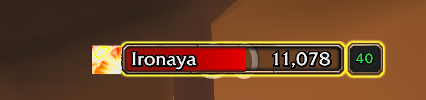
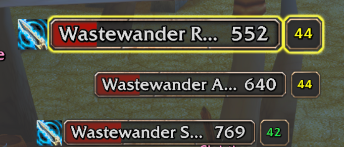

# WisdomTracker

A small World of Warcraft Forever addon that displays other players' Judgement of Wisdom and Judgement of the Crusader on enemy nameplates.

The client manages aura filtering and icon visibility through native AuraContainers. The addon does not scan protected aura data.

## Features

- Tracks the Wisdom and Crusader ranks listed below, independently configurable.
- Shows up to one icon for each judgement, with 22-pixel icons and 3-pixel spacing.
- Places icons beside the health bar, on the left by default or optionally the right.
- Saves tracking and position settings per character.
- Excludes the player's own casts. Casters are not restricted to party members.

## Examples

Judgement of the Crusader beside an enemy health bar:



Judgement of Wisdom on multiple enemies:



## Installation

1. Copy the inner `WisdomTracker` folder into your client's `Interface/AddOns` directory.
2. Confirm that the installed layout is `Interface/AddOns/WisdomTracker/WisdomTracker.toc`.
3. Enable Wisdom Tracker in the AddOns list and enable enemy nameplates.
4. Run `/reload` if the addon was already installed. If this is the first installation and the client does not list it, restart the client.

Install only the inner addon folder; the repository root contains development files.

## Commands

Use `/wt` or `/wisdomtracker` to show settings and diagnostic status. Change settings outside combat.

| Command | Action |
| --- | --- |
| `/wt wisdom on` | Enable Wisdom tracking |
| `/wt wisdom off` | Disable Wisdom tracking |
| `/wt crusader on` | Enable Crusader tracking |
| `/wt crusader off` | Disable Crusader tracking |
| `/wt position left` | Place icons beside the left edge of the health bar |
| `/wt position right` | Place icons beside the right edge of the health bar |

Both judgements are enabled by default. Position and tracking changes apply immediately when supported by the client. If a native update fails, the diagnostic message requests a reload to apply the saved settings.

## Compatibility

Wow: Forever Only

## Tracked spell IDs

| Spell family | IDs |
| --- | --- |
| Judgement of Wisdom | 20186, 20354, 20355 |
| Judgement of the Crusader | 21183, 20188, 20300, 20301, 20302, 20303, 20304, 20305 |

## Repository layout

```text
WisdomTracker/
  WisdomTracker.lua
  WisdomTracker.toc
README.md
CHANGELOG.md
.gitignore
.gitattributes
.editorconfig
```

The installed game copy and this repository are separate folders. To test a source change, copy the two addon files from the inner folder into the installed addon folder, then reload the UI.

## Manual verification

- Have another paladin apply and refresh each tracked judgement; confirm the matching icon appears and disappears with the debuff.
- Check with both judgements present, during party combat, and after nameplates disappear and reappear.
- Toggle each spell independently and confirm the other spell remains enabled.
- Switch between left and right positioning, then reload and confirm the selection persists.
- Check `/wt` for diagnostics and confirm there are no aura-access or taint errors.

## Credits

The native AuraContainer approach and judgement rank catalog were informed by ClassicNameplatesPlus 1.0.14 by Wurmschwanz. Source attribution is retained in the addon.
